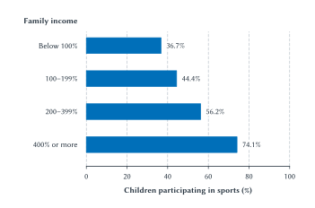

# Sports Participation, Health, and Public Policy

Imagine a parent seeing an advertisement for a free neighborhood baseball league. The registration fee is gone. Equipment is available. The child wants to play. What could still prevent the family from signing up?

Practice might begin before the parent leaves work. The bus route might not reach the park. A younger sibling might need care during games. The family might learn about registration after the available places are filled. Removing one barrier can be valuable without removing every barrier.

This is more than a hypothetical starting point for students from Western New York. Project Play Ball! announced free baseball, softball, and T-ball leagues for Buffalo children ages 4–13 in 2025. Neighborhood organizations offered play at four city parks, with partners supplying equipment and supporting coach training. The initiative brought together existing facilities, community providers, and charitable support.[^buffalo-play]

The offer raises an economic question: what does it actually cost to participate in sports, and which part of that cost should a policy try to change?

Most of this book has examined people watching sports and businesses selling that experience. Here we turn to people playing. The participants include children in school teams, adults joining basketball leagues, runners using a public trail, and older residents attending a pool exercise class. Their decisions involve familiar ideas: incentives, scarce resources, consumption, investment, externalities, and opportunity cost.

The policy question also changes. Instead of asking whether a city should subsidize a professional stadium or host a global event, we ask how it should evaluate a recreation center, an after-school league, fee assistance, or longer pool hours. The useful comparison is what people gain from the proposal relative to what those resources could accomplish elsewhere.

## Learning Goals

After reading this chapter, you should be able to:

- distinguish organized sports, informal recreation, and physical activity
- explain the full cost of participation, including money, time, and access
- analyze household sports spending as consumption and possible investment
- explain how providers' costs and capacity affect participation opportunities
- interpret participation differences without confusing association with causation
- distinguish private health benefits, possible external benefits, and access objectives
- evaluate school athletics, gender equity, and barriers faced by people with disabilities
- compare recreation policies by asking which constraint each addresses and what changes because of it

This is a conceptual chapter. You should be able to interpret its percentages and comparisons, but no arithmetic or algebra is required.

## What Families Gain From Playing

::: keypoint
**Sports Are Also Participation Markets**

Sports economics is not only about leagues, tickets, and media. Participation sports involve households, schools, public facilities, health, and access.
:::

A person can value sports without buying a ticket or following a professional team. The activity itself can be the product. A pickup basketball game provides exercise and competition. A recreational softball team gives friends a reason to meet each week. A swimming lesson can be enjoyable while developing a useful skill.

Economists distinguish **consumption**, which provides benefits now, from **investment**, which uses resources today in the hope of benefits later. Participation can do both. The child enjoys the game today and may develop fitness, skills, or relationships that matter afterward.

That distinction prevents an unnecessarily narrow evaluation of youth sports. A season does not need to produce a college scholarship to have been worthwhile. Families also purchase vacations, music lessons, and other experiences because they enjoy them. A parent can reasonably value a child's friendships or enjoyment even when the experience produces no measurable earnings increase.

The investment side still deserves attention. A parent may hope that sports will help a child learn to practice consistently, work with others, or respond to setbacks. An adult may exercise partly to preserve health and the ability to keep working. These are expected benefits, subject to uncertainty. Spending more does not guarantee that a particular benefit will follow.

The relevant alternative matters. Time at practice might otherwise be spent studying, working, playing music, exercising independently, or doing very little. The return to participation depends partly on what it replaces. The same sports program can therefore have different benefits for different people.

Participation also extends well beyond organized teams. **Organized sport** generally involves an arrangement such as a team, club, lesson, or scheduled competition. **Informal recreation** includes activities such as pickup games or playing catch. **Physical activity** is broader still and includes walking or cycling for transportation. These categories overlap, but they are not interchangeable.

A survey asking whether someone joined a team will miss some people who are very active. A count of gym memberships will include some people who rarely visit. Before interpreting a statistic, ask what behavior it measures.

### The Full Cost Of Participation

The registration fee is only one part of the family's decision. Equipment, uniforms, transport, lodging, and lessons may require additional spending. Parents and children also commit time. Practices can conflict with paid work, homework, another child's activities, or rest.

The **opportunity cost** of that time is the value of the best alternative use of it. It need not appear on a receipt. A parent who gives up an evening shift faces a different cost from a parent who can adjust a work schedule without losing income. A student who enjoys attending practice still gives up the chance to do something else during those hours.

Costs and enjoyment can exist together. Watching a child play may be one of the best parts of a parent's week. We should count that enjoyment as a benefit while recognizing the scarce time involved. Calling time a resource cost does not mean that every minute spent at a game is unpleasant or should be valued mechanically at an hourly wage.

::: quickconcept
**The Full Cost Of Participation**

The money price is part of the cost. A family's decision also depends on equipment, travel, scheduling, time, and the difficulty of reaching and using the opportunity. A lower fee may have little effect if another constraint remains binding.
:::

Suppose two families receive the same offer for an after-school soccer program. One child can walk from school to the field, and a parent can collect the child afterward. The other needs an adult to leave work early and drive across town. The posted fee is identical, but the practical offer is different.

This is why convenient scheduling can sometimes do more than a small fee reduction. It is also why a fee reduction can matter greatly to a family that already has transport but cannot afford registration. There is no reason to assume one barrier dominates everywhere.

Income changes the choices available, but it does not summarize all constraints. A family with adequate income may lack flexible work hours. A low-income household may have a nearby program, help from relatives, and a child who can participate at little additional expense. Policy needs more information than the fee or the family's income alone.

## Who Supplies The Opportunity?

Participation requires someone to organize the offer. Schools supply teams, physical education, and facilities. Municipalities operate parks, pools, and recreation programs. Nonprofits organize neighborhood leagues. Commercial businesses sell instruction, camps, gym access, and club participation. Families and friends also organize play themselves.

These providers combine resources. A baseball program needs a place to play, scheduling, equipment, supervision, and some way to maintain the field. A swimming program requires a usable pool and people who can operate it safely. Insurance, training, administration, and maintenance can matter even when players never notice them.

Some providers pay employees. Others depend heavily on volunteers. Volunteer time is a contribution of resources rather than evidence that producing the program costs nothing. A league that loses its volunteer organizer can have trouble operating even when the field and equipment remain available.

Funding can come from several places: participant fees, taxes, donations, sponsorship, fundraising, or school budgets. A free program moves the financing burden away from the participant. Someone still supplies the resources. The economic question is whether that arrangement produces benefits worth the resources used and how those benefits and burdens are distributed.

The provider's objective also matters. A school might want broad student involvement. A commercial club might sell intensive training to families seeking a particular level of competition. A neighborhood league might emphasize convenient access and playing time. Each can offer something valuable, but their success should not be measured by the same scoreboard.

### Why Travel Sports Can Become Expensive

Travel sports combine several products: coaching, practice, competition, tournaments, and access to teammates and opponents at a desired level. Families may value a better competitive match or the experience of traveling together. Some may hope for later opportunities. Those benefits should be considered rather than assuming that every expensive program is merely exploiting parents.

The costs can also be substantial. Travel uses vehicles, fuel, lodging, and time. Facilities and coaching may be scarce. More intensive participation can mean buying more of the product rather than paying a higher price for an unchanged experience. A family's rising annual bill could reflect higher prices, more tournaments, more lessons, or a switch to a different level of play.

An Aspen Institute survey conducted in late 2024 asked 1,848 youth-sports parents about their oldest child who regularly participated. Reported spending on that child's primary sport over the preceding year averaged about \$1,016, including registration, equipment, travel, instruction, camps, and other expenses.[^parent-survey] The estimate describes the participating families in that survey. It is neither a minimum cost of playing nor an average for all families with children.

That distinction matters. A household whose child does not participate because it cannot afford the offer is outside this spending comparison. Average spending among those who bought the product does not tell us how affordable the product is to those who did not.

Nor does a large bill establish a large profit for the provider. Lodging spending may go to a hotel, equipment spending to a retailer, and registration receipts toward facilities or staff. We would need information on revenue and cost to assess profitability. The family's full financial burden and one organization's profit are different objects.

### When Improvement Becomes A Positional Contest

There is another possible source of spending pressure. Suppose several children compete for a limited number of places on a highly selective team. Extra instruction may improve each child's ability. It may also improve one child's chance of taking a place that would otherwise go to another.

The first effect can increase the total skills developed. The second is partly **positional**: the advantage depends on ranking above someone else. If everyone purchases extra instruction, the standard can rise without any increase in the number of available places. Each family's decision may make sense individually even when part of the collective spending simply changes who wins the contest.

This connects to Chapter 11's discussion of institutions that channel competition. Competition can develop ability and generate enjoyment while also encouraging spending to obtain scarce status or opportunities. The task is to identify both effects, not to classify all competition as wasteful.

A provider's rules can change the incentives. A league organized around broad participation and guaranteed playing time creates a different experience from one built around selective rosters and constant advancement. Neither design can be evaluated solely by its championship record. We need to ask what families seek, what children gain, and which opportunities remain available to those who prefer less intensive participation.

## Who Gets To Play?

The National Survey of Children's Health provides a useful description of participation. In pooled 2023–24 data, 56.7% of U.S. children ages 6–17 were reported to have played on a sports team or taken sports lessons after school or on weekends during the preceding year.[^nsch-participation]

Participation differed substantially across income groups. It was 36.7% among children in families below the poverty threshold and 74.1% among children in families at four times that threshold or above. Figure 12.1 shows the full set of published income groups. Income is measured relative to a poverty threshold that accounts for family circumstances, rather than as four fixed dollar amounts.

**Figure 12.1: Participation and family income.** Weighted, parent/caregiver-reported participation among U.S. household children ages 6–17, pooled 2023–24 NSCH. Participation means a sports team or lessons after school or on weekends in the past year. The income groups are percentages of the poverty threshold. The pattern is descriptive; the bars do not isolate the effect of income or fees. Source: HRSA/MCHB, July 2026.[^nsch-participation]

::: aifiguredescription
**Figure description: fig:ch12-participation-and-income**

This is a horizontal bar chart with four blue bars and no causal arrows or fitted line. The horizontal axis is Children participating in sports (%), running from 0 to 100 with ticks at 0, 20, 40, 60, 80, and 100. The vertical categories, ordered from top to bottom, are family income below 100%, 100–199%, 200–399%, and 400% or more of the poverty threshold. Their respective bar endpoints and direct labels are 36.7%, 44.4%, 56.2%, and 74.1%. All bars begin at zero and use the same linear scale. Labels identify income relative to the poverty threshold, not fixed dollar-income brackets. The estimates are published weighted NSCH values for children ages 6–17 in U.S. households, pooled across 2023 and 2024, reported by a parent or caregiver for team participation or sports lessons after school/on weekends during the preceding year. The July 2026 HRSA brief is the source. The national overall rate of 56.7% is discussed in prose but not plotted as a fifth category; it is not an unweighted average of the four bars. No confidence intervals or subgroup sample sizes are displayed. The increasing pattern is an association. It does not estimate a price elasticity, identify an income or fee effect, show all physical activity, distinguish paid from free participation, or establish an efficient participation target. Fees, transport, time, local supply, program fit, preferences, and other factors could contribute to the pattern.
:::

The pattern is consistent with resources and access mattering. It does not tell us how much of the difference a fee waiver would remove. Families differ in transport, schedules, facilities nearby, information, and preferences as well as income. A statistical comparison that does not separate those influences cannot identify each one's effect.

We should also avoid reading the bars as a ranking of how much parents care about their children. A household's observed choice reflects both what it values and what it can do. Chapter 2's demand analysis made the same point: willingness and ability to buy both matter. Here the offer includes practical access as well as a posted price.

### An Opportunity Must Be Usable

Consider a school that adds a team but schedules practice when some students must take the last available bus home. The roster places exist, yet the opportunity is harder to use for those students. Similarly, a program may be nearby but offer no suitable equipment or instruction for a child with a disability.

Disability access can involve physical design, adapted equipment, trained staff, transport, and a suitable form of play. These are potential production and participation constraints. Removing one can expand the usable offer even if the registration price remains unchanged. The appropriate response depends on the people and activity involved; one uniform program need not meet every need.

Geography matters too. A rural community may have fewer nearby opponents or facilities. A densely populated neighborhood may have scarce field time or difficult travel connections. The relevant question is which constraint applies, rather than assuming every place needs the same new building.

Gender differences require similar care. The federal brief reports participation of 60.7% for boys and 52.6% for girls in its survey categories.[^nsch-participation] The difference describes participation, not its cause. Available sports, schedules, coaching, prior experience, and social expectations can shape choices alongside preferences. The school-sports case below shows why the history of available opportunities matters when interpreting observed participation.

## Health Benefits: Sport Is One Route To Activity

The health case for physical activity is well established. The federal guidelines' evidence review identifies benefits involving fitness, bone health, cognition, and several other outcomes among children and adolescents. For adults, the evidence includes lower risks of several chronic diseases and benefits for physical function, sleep, and mental health.[^physical-activity]

For this chapter, the economic implication is that participation can provide benefits extending beyond the immediate game. A person may value how activity makes the present day feel and how it affects future health. Those benefits belong in an assessment of the activity's value even when nobody earns revenue from them.

But a sports label does not measure how much activity occurs. A child can spend part of practice waiting for a turn. Another child may be active through informal play without belonging to a team. Walking, cycling, swimming, and other forms of recreation can provide activity outside organized competition. A policy aimed at health should identify the relevant behavior instead of assuming that any additional registration produces the same benefit.

The distinction appears in the federal survey. Among children reported to have participated in sports during the preceding year, 21.7% were reported to have at least 60 minutes of physical activity on every day of the preceding week, compared with 17.0% among nonparticipants.[^nsch-health] These are different reference periods and different measures. Joining a sport sometime during a year is not the same event as being active every day of a particular week.

### Selection And Reverse Causality

Participants may differ from nonparticipants before the program begins. Families with greater resources may find participation easier and also have access to other things that improve health. Children who already enjoy being active may be more likely to join. A health condition may make joining more difficult.

That last possibility is **reverse causality**: health affects participation, even as participation may affect health. The HRSA brief explicitly cautions that its cross-sectional comparisons cannot establish the direction of these relationships.[^nsch-health]

::: warning
**A Healthy-Athlete Comparison Does Not Measure A Program's Effect**

To estimate what participation changes, we need a credible account of what would have happened to comparable people without it. Health differences between current participants and nonparticipants can reflect selection, reverse causality, and other differences as well as benefits from activity.
:::

This does not erase the benefits established in the physical-activity literature. It limits what a particular comparison can tell us. Evidence that activity improves health and evidence that a proposed league will increase activity are two steps in the argument. A sound policy case needs both.

### Additional Activity, Quality, And Risk

Suppose a community opens an indoor court and its attendance is high. Some visitors may be exercising more than before. Others may have moved from another gym or from playing outside. The new facility may still be valuable because it is more convenient or enjoyable, but its attendance total does not measure the increase in total activity.

The same reasoning applies to a sports subsidy. It may bring in new participants, keep existing participants involved, improve the experience, or reduce families' spending. Those are different changes. Evaluating a health objective requires attention to the activity that occurs because of the policy.

Program quality also matters. Age-appropriate coaching, usable facilities, and a setting in which people want to return can affect the experience. Injuries are a possible cost of activity, and risks differ across activities and participants. Federal guidance emphasizes appropriate activities, safe settings, equipment, and gradual increases in activity.[^physical-activity] A benefit-cost assessment should include relevant risks without assuming that either the cheapest or the most intensive program must be best.

The policy aim is therefore more specific than getting a name onto a roster. It is to expand worthwhile opportunities that people can use and sustain, while considering what they would otherwise have done.

## Which Benefits Support Which Policy Argument?

Many people hear that physical activity improves health and immediately conclude that government should subsidize sports. There can be a case for public support, but the reasoning requires another step. We must identify why the private decision leaves out a benefit, why a constraint should be reduced, or why citizens want to redistribute access.

Chapter 3 defined a positive externality as an uncompensated benefit to someone outside the transaction. Most of a participant's enjoyment and better health accrues to that participant. Those are real benefits, but calling them external would confuse who receives them.

The distinction affects the policy prescription. If someone understands and values an activity's full benefits, can afford the available offer, and bears its costs, the fact that the activity is healthy does not by itself establish underconsumption. We need a further reason to believe the private choice omits something relevant or that the available choices should change.

### Possible Benefits To Others

Some effects can reach beyond the participant. A program might create social connections that benefit neighbors or support activities other residents value. Changes in health could affect costs paid through shared insurance or publicly financed care. A school program might create learning or peer benefits that are not fully captured by the individual student.

Each possibility needs a mechanism. Who benefits? Would the benefit occur without the program? How much of it does the family already consider? A claim that sport automatically reduces crime or generates large public medical savings is not established merely by naming a possible channel.

Fiscal effects also require care. Avoiding a medical expense can save resources, but the amount saved by a particular government depends on who would have paid and how the policy changes health over time. We cannot take the total health value to the participant and count the same value again as a saving to taxpayers. Nor should we assume every improvement in long-term health produces a matching reduction in lifetime public expenditure.

These distinctions do not make public support impossible. They make the argument specific enough to evaluate.

### Information, Time, And Children's Choices

Another possible argument concerns decisions with future consequences. People may have incomplete information about an activity or difficulty following through on plans. A parent may be uncertain about a new program's safety, schedule, or quality. Children do not make all the financial and transport decisions that govern their own opportunities.

Different problems call for different responses. Clear information could help a family evaluate an unfamiliar league. A reliable after-school schedule could make participation feasible. Fee assistance addresses affordability. A larger subsidy is not automatically a substitute for information or a workable timetable.

We should also avoid treating every decision to decline sports as a mistake. A child may prefer music, another activity, or a less competitive form of recreation. The objective is to expand valuable choices, with attention to the reasons people do or do not use them.

### Access As A Separate Objective

A community may support children's participation because residents believe that family income should not determine access to certain opportunities. This is a **distributional objective**: a judgment about who should be able to obtain the benefits. It does not require relabeling every private benefit as an externality.

The objective still needs an operational definition. Is the priority to help the least active children, those facing financial barriers, people with disabilities, or all residents? A program that improves access for one group may leave another group's constraints unchanged. Stating the objective makes it possible to judge the policy against what it is supposed to accomplish.

| Example | Who receives the benefit? | What follows for policy? |
| --- | --- | --- |
| Enjoyment and friendships | Primarily participants and their families. | Count these as benefits; do not require a future earnings return. |
| The participant's better health | Primarily the participant; some effects may reach others. | Separate private gains from any specific spillover. |
| Lower costs paid through shared medical financing | Potentially insurers, taxpayers, or other members of the financing pool. | Establish the change in care, who pays, and the relevant time period. |
| Skills and future opportunities | Primarily the participant, with possible effects on peers or others. | Ask what participation caused and what alternative activity it replaced. |
| Opportunities for children facing access barriers | The children and families helped; citizens may also value wider access. | State the access goal and examine who the program actually reaches. |

**Table 12.1: Benefits and policy rationales.** Private benefits, possible spillovers, and distributional objectives can all matter, but they are different arguments. Listing a possible benefit does not measure it or establish the best intervention.

::: warning
**Public Health Benefits Do Not Eliminate Opportunity Cost**

Even when participation has health benefits, public spending still needs comparison with alternative uses of funds.
:::

That comparison includes alternatives within recreation. An additional hour of accessible swimming, a safe walking connection, and a selective tournament program may reach different people and produce different experiences. A proposal should explain why its particular design serves the stated objective.

## School Athletics, Human Capital, And Gender Equity

Schools can make participation easier by bringing students, facilities, and supervision together. An after-school program may reduce the coordination burden that a family would otherwise face. Shared facilities can serve several activities over the day rather than requiring every organization to build its own.

School provision still uses scarce resources. Coaches and supervisors need time. Fields and gyms require maintenance. Transport costs money. Students who play sports allocate time that could be used for study, employment, other clubs, or rest. A school deciding how much to devote to athletics must compare those uses rather than assume its budget has no alternative.

The question of what sports develop is partly a **human capital** question. Human capital consists of skills, knowledge, and capabilities that can make people more productive. Teamwork, practice habits, and the ability to respond to feedback could matter beyond the playing field. But observing that former athletes do well later does not tell us whether sport produced those capabilities or attracted students who already had them.

Sports may also help others recognize an existing skill. A coach's recommendation or a leadership role could signal something about a student. Developing a capability and revealing an existing capability are different mechanisms. Both may affect the participant's opportunities, but they do not imply identical benefits to society from adding another roster place.

### A Research Case: Expanding Girls' Opportunities

The expansion of girls' school sports following Title IX, enacted in 1972, provides a useful historical case. Economist Betsey Stevenson examined whether the expansion affected women's later education and employment.[^titleix-sports]

Her approach went beyond comparing people who chose to play with people who did not. Before the reform, states differed in the extent of boys' high-school sports participation. States with more extensive opportunities for boys faced pressure for a larger expansion of opportunities for girls. Stevenson used that difference, together with comparisons of earlier and later cohorts, to study what followed the expansion.

This is a **quasi-experiment**: a policy or institutional change supplies a comparison that can help separate cause from selection, even though researchers did not randomly assign children to sports. The usefulness of the comparison depends on the assumptions connecting the policy change to the outcomes.

Stevenson found evidence that expanded opportunities improved women's educational and employment outcomes. Her interpretation requires that other changes related to states' earlier boys' participation did not generate the apparent effect. The study examined alternative explanations and patterns before the reform. It also recognized that Title IX could change college athletic opportunities as well as high-school participation.[^titleix-sports]

The result is evidence about a historical expansion of opportunity under the study's assumptions. It is not a promise that joining any present-day team will produce a particular wage gain. It also does not tell a school that sports must always have a higher return than music, academic support, or another use of its resources.

::: sideline
**Available Choices Shape Observed Choices**

If students have never had a practical chance to play, low participation does not reveal how many would join a usable program. Conversely, creating places does not guarantee that every student will want one. The school-sports case asks what happened when the available choices changed.
:::

### Which Students Receive The School's Resources?

A school might improve a highly competitive varsity team, expand intramural play, or offer introductory instruction. Those choices can serve different students. Improving the experience of current athletes may be a legitimate goal, but it is different from reaching students who currently lack an opportunity.

Pay-to-play fees add another decision. They can help finance a program while excluding some students or changing which activity a family chooses. A waiver can reduce the money barrier, but its effectiveness also depends on whether families know about it, can obtain it, and have transport and time. Team cuts and facility capacity can limit access even when the fee is waived.

Gender equity similarly concerns the usable offer: activities, facilities, coaching, schedules, and opportunities to develop skills. A participation count is useful evidence, but it does not fully describe those conditions. The economic task is to identify what resources and institutional choices shape access, then evaluate a feasible change.

## Parks, Pools, Fields, And Operating The Program

Public recreation can serve people who have little connection to organized teams. A trail can support walking and cycling. A pool can provide lessons, lap swimming, and recreation. A court can host formal leagues and informal games. The same facility can create several kinds of value over its useful life.

But a facility is useful only to the extent that people can use it. A locked gym, an unreliable pool schedule, or a field without necessary maintenance can provide less value than its construction cost might suggest. Staffing, repairs, opening hours, and program organization are part of the production decision.

This makes the distinction between **capital spending** and **operating spending** useful. Capital spending creates or improves a durable asset. Operating spending helps supply the service over time. A community can obtain a new building and still lack the staff or maintenance budget needed to operate it well.

### Public Ownership And Scarce Capacity

Public ownership does not eliminate rivalry in use. Two leagues may want the same field at the same time. A crowded pool can require admission limits. A court can serve only a certain number of games during an evening. Some recreation services are excludable through reservations, fees, or eligibility rules, even when the public owns the facility.

These are applications of Chapter 3's distinction between public goods and other publicly provided services. An uncrowded open space may accommodate an additional visitor at little cost. A scarce swimming lesson requires instructor time and a place in the class. The appropriate funding and allocation arrangements can differ.

When the fee is low and demand exceeds available places, allocation does not disappear. It can occur through waiting lists, advance reservations, lotteries, priorities, or simply knowing when registration opens. Students should recognize the same problem encountered with inexpensive but scarce tickets: the money price does not tell the whole allocation story.

A policy aimed at broad access should therefore examine its allocation rules. A first-come system may be convenient to administer while favoring families with information, flexible schedules, or the ability to register immediately. Whether that matters depends on the program's objective and the alternatives available.

### What Does The Parks Evidence Show?

The Community Preventive Services Task Force distinguishes improvements to parks, trails, and greenways from improvements accompanied by other interventions. Those additions can include programs, outreach, community engagement, transport connections, safer crossings, or expanded opening hours.

Its review recommends infrastructure improvements combined with additional interventions to increase physical activity. For infrastructure implemented alone, the task force found insufficient evidence to determine the effect on physical activity because results were inconsistent. Studies did find increased use of parks, trails, and greenways.[^parks-activity]

The difference is economically useful. Building or renovating a place changes one input. Programming or access improvements can change whether the intended users take advantage of it. A count of visitors measures use of the location; it need not measure the change in each person's total activity.

Insufficient evidence is not a finding that the investment has no value. Recreation, enjoyment, environmental amenities, and convenience can also matter. A separate economic review summarized by the task force found benefits exceeding costs for the infrastructure interventions studied. That review did not establish the benefit-cost performance of every proposed facility or of the combined interventions as a group.[^parks-economics]

The defensible lesson is to evaluate what the project supplies, who uses it, and what changes because of it. Neither a positive national review nor an uncertain activity estimate should replace examining the local proposal.

### Use Existing Capacity Or Build More?

Suppose a town is considering a new recreation building while an existing school gym is unused during some evenings. Opening the gym might provide part of the desired service at lower capital cost. It might also require supervision, cleaning, scheduling, security, and agreement about responsibility for damage. Existing capacity can be valuable without being costless to use.

In another setting, the existing facility may already be fully occupied, inaccessible to the intended users, or unsuitable for the activity. A new facility could then be the relevant option. The comparison should concern feasible alternatives, not an imaginary free building that is always available at the right time.

Land and maintenance belong in the calculation too. Donated land still has an opportunity cost if it could serve another valuable use. A facility's future repair obligations do not disappear because the ribbon-cutting budget excludes them. User fees help finance the service, but the payment moves money from users to the operator. If we have already counted users' gross value from using the facility, adding the fee again as a separate social benefit would double count. The operator's budget can still record the receipt as revenue.

The same logic from the stadium chapters applies: count benefits and resource costs against one realistic alternative. The benefits here may come mainly from participation, enjoyment, access, and health rather than new visitor spending. Their value does not depend on producing a large local-income multiplier.

## Return To Buffalo: Which Barrier Should The Next Dollar Remove?

The Project Play Ball! announcement shows an arrangement worth examining. Neighborhood organizations used existing Buffalo parks to offer free house leagues. Partners supplied equipment and supported coaching. Project Play WNY operates through foundation support and collaboration with the Community Foundation for Greater Buffalo.[^buffalo-play]

The arrangement illustrates how several inputs can be brought together. Public facilities, charitable support, community organizers, and family time can contribute to the same experience. The announcement documents the offer. It does not tell us how many additional children became active, which families could not join, or what would have happened without the initiative.

::: casestudy
**A Free League And The Next-Dollar Decision**

Consider a hypothetical recreation decision inspired by the Buffalo example. A community has an established youth program and a limited amount of additional funding. It can expand fee and equipment assistance, improve transport and scheduling, add coaches and sessions, or improve available facilities.

Suppose interviews suggest that some children cannot afford equipment, others lack a way to reach practice, and the most convenient sessions are full. There is no reason to expect one intervention to solve all three problems. The first task is to learn which barriers prevent which children from participating.

An equipment program may reach children who already have a usable place and transport. A ride or a later session may help families for whom another fee reduction would change little. More coaching capacity may matter most if every accessible session is already full.

Which option would you recommend first? State the program's objective, the barrier you expect it to remove, and the evidence that would cause you to change your recommendation. The choices and constraints in this exercise are hypothetical, not findings from an evaluation of Project Play Ball!.
:::

| Intervention | Barrier it can address | Evidence to look for |
| --- | --- | --- |
| Fee or equipment assistance | An unaffordable money cost. | Eligible families have usable places; assistance changes enrollment or continued participation. |
| Transport or convenient scheduling | A place is difficult to reach or conflicts with family obligations. | Intended users can attend more reliably and actually use the changed offer. |
| Coaches, maintenance, or additional sessions | Existing operating capacity or quality is inadequate. | Previously constrained users obtain suitable places or a better experience. |
| Joint use or improvement of existing facilities | Facilities exist but are unavailable, unsuitable, or difficult to access. | Usable hours or access expand after including operating and coordination costs. |
| New facilities | Appropriate capacity is genuinely insufficient. | Credible demand and access plans justify construction and continuing operation relative to alternatives. |

**Table 12.2: Match policy to the barrier.** These interventions are options to investigate. Their relative value depends on the program's objective, supply constraints, who responds, and what would occur without the intervention.

### Who Receives The Assistance?

A subsidy can help families who would have participated anyway. They gain financial relief, which may serve an access or distributional objective. But those payments do not automatically create additional participation. An evaluation should distinguish help to existing participants from changes in enrollment, retention, or activity.

Supply responses matter as well. If families receive assistance to purchase places from private providers while suitable places are scarce, part of the benefit could appear in higher provider prices. If providers can add sessions, hire coaches, or expand facilities, more of the response can take the form of additional opportunity. Chapter 3's incidence reasoning applies even when the transfer is described as support for children.

That does not imply all providers will raise prices or that subsidies cannot work. It means the policy needs an account of supply. A program can combine assistance with measures that expand capacity or make existing capacity usable. The mix should follow the problem rather than the name of the funding program.

### Measure The Outcome That Matches The Objective

If the objective is initial access, track whether the intended children obtain places. If it is sustained participation, examine attendance and retention. If it is health, investigate whether total activity or relevant health outcomes change. If it is enjoyment and social connection, those experiences deserve attention rather than being replaced with a more convenient revenue statistic.

Evaluation should also look at who remains outside. A successful registration total may conceal continued exclusion of families without transport or children who need a different form of instruction. Learning that a program works well for one group can help improve it; it does not establish that it meets every need.

## A Participation Policy Checklist

Before recommending a participation policy, ask five questions:

1. **Who faces which barrier?** Identify the intended users and distinguish fees, time, transport, information, program fit, and capacity.
2. **What changes because of the proposal?** Compare it with what families and providers would otherwise do, including other activities displaced.
3. **Which benefits belong to whom?** Count enjoyment, health, skills, and any supported spillovers. State access goals separately.
4. **What resources and alternatives are involved?** Include operating costs, volunteer time, land, future obligations, and another feasible use of the budget.
5. **How will success be evaluated?** Choose outcomes that match the objective and examine who gains usable access.

This checklist gives the chapter a common economic structure. A school team, a private club, and a public pool involve different institutions, but each connects choices to constraints and uses resources that could have been used elsewhere.

## Big Picture

Participation sports create value through what people do and experience. Enjoyment, friendships, health, and skills can matter even when they never appear as a ticket receipt or a local-income estimate.

The full cost of obtaining those benefits includes more than the posted fee. Providers must assemble facilities, coaching, schedules, and funding. Families need a usable offer. A free place that cannot be reached and a new facility that cannot be operated leave important constraints unresolved.

Good policy begins by identifying those constraints. It then asks what the proposed change accomplishes, who gains, and what resources it uses. Evidence can establish a participation pattern without proving its cause, and it can support a general activity benefit without measuring a particular program's return.

The following labor chapters examine how skills, performance, and institutions affect opportunities and earnings in sports. This chapter supplies an earlier part of that story: who obtains the chance to participate and what they may gain from doing so.

## Study And Learn

### Key Terms

- organized sport
- informal recreation
- physical activity
- consumption and investment
- full cost of participation
- opportunity cost
- positional competition
- reverse causality
- private benefit and external benefit
- distributional objective
- human capital
- quasi-experiment
- capital spending and operating spending
- capacity and congestion

### Review Questions

1. How can two families face the same registration fee but different full costs of participation?
2. Why can participation be worthwhile even if it produces no scholarship or earnings increase?
3. What resources must a provider obtain even when participants pay nothing?
4. What does Figure 12.1 show, and why does it not identify the effect of a fee waiver?
5. How can reverse causality affect a comparison of participants' and nonparticipants' health?
6. Distinguish a participant's health benefit, a possible external benefit, and a distributional reason for support.
7. What makes the school-sports study more informative than a simple comparison of athletes and nonathletes? What assumption still matters?
8. Why might programming or improved access change the value of a facility investment?

### Problems And Applications

These questions require explanations rather than calculations. Use the parties' incentives, the actual constraint, and a realistic counterfactual.

1. **The evening practice.** A school eliminates a participation fee, but practice ends after the last school bus leaves. Enrollment changes little. Offer an economic explanation and identify evidence that would help test it.
2. **The crowded swimming class.** Every suitable class has a waiting list. A community offers families vouchers for those classes. Explain possible effects on prices, access, and providers' incentives to expand. Do not assume a response without stating the supply conditions.
3. **The expensive team.** A family purchases more travel, tournaments, and instruction than in the previous season. Explain why its higher annual spending does not by itself measure inflation, provider profit, or improved child welfare.
4. **The healthy participants.** An organization reports that its participants have better health than nonparticipants. Explain selection, reverse causality, and one feature of an evaluation that would make the causal claim more persuasive.
5. **The new gym.** A town proposes new construction while a school gym is unused on some evenings. Compare the alternatives, including operating costs, suitability, access, and the possibility that existing capacity cannot meet the demand.

### Evidence Activity: Audit A Local Participation Offer

Choose a school, municipal, nonprofit, or commercial participation program. Use a current provider source and record its date or your access date. Identify the intended users, what is offered, the fee and other visible requirements, and any important cost or access information that is missing.

Then explain which barrier a proposed improvement would address, who would benefit, and what you would measure to learn whether it worked. Separate documented terms from your hypotheses. A provider's account of its mission is useful information about its objective; it is not an independent estimate of the program's effect.

::: studyandlearn
**Use The Chapter As An AI Tutor**

Upload the chapter Markdown and ask for conceptual practice, one question at a time. Have the tutor ask you to identify a barrier, distinguish private benefits from spillovers, interpret the income chart, or evaluate a program claim. Explain your reasoning before asking for feedback. This chapter requires no calculations; the task is to understand what the evidence and economic mechanisms imply.
:::

::: aitutor
**AI tutoring protocol: Chapter 12**

This is a conceptual chapter with no required arithmetic or algebra. Do not invent calculation requirements, subsidy optima, elasticities, scholarship probabilities, or monetary health returns. Ask one question at a time and request the student's reasoning before supplying an explanation. Interpret the four income bars as published descriptive percentages, not causal effects or estimates of all physical activity. Preserve the measure, ages, pooled years, income definitions, and actual values in the figure description. Do not turn parent spending among active families into a minimum participation price or an average for all households. Keep private health benefits, possible external benefits, and distributional objectives distinct. A public facility is not automatically a pure public good; capacity and allocation rules can matter. Treat the next-dollar program exercise as hypothetical and the Buffalo announcement as documentation of an offer, not an impact evaluation. Preserve the assumptions and historical scope of the school-sports research. Do not imply that group participation differences alone establish their causes, that a healthy-athlete comparison proves a program effect, that insufficient evidence proves no benefit, or that all health improvements produce matching taxpayer savings. Use the chapter and its Source Notes rather than inventing current programs or legal rules. Start with ordinary language, offer a targeted hint if needed, and explain the mechanism after the student attempts an answer.
:::

## Source Notes

[^buffalo-play]: Project Play WNY, “Registration Now Open for Project Play Ball! — Free Softball, Baseball & T-ball Leagues for the East Side, West Side and Black Rock Communities in 2025,” <https://projectplaywny.org/blog/registration-now-open-for-project-play-ball-free-softball-baseball-t-ball-leagues-for-the-east-side-west-side-and-black-rock-communities-in-2025/>, accessed October 22, 2026. Page header dated December 19, 2024; release body datelined December 9, 2024. Documents the announced 2025 offer, four parks, partner organizations, equipment support, coach-training support, and Project Play WNY's foundation/community-foundation arrangement. It does not provide an independent program-impact evaluation or complete program accounts.

[^parent-survey]: Travis E. Dorsch and Jordan A. Blazo, *2024 Parenting Survey: Final Report*, prepared for the Aspen Institute's Project Play, released 2025, <https://www.aspeninstitute.org/wp-content/uploads/2025/06/National-Youth-Sports-Parent-Survey-FINAL.pdf>, especially sections 1.1, 2.3, and 3.2, accessed October 22, 2026. Online data collection November 5–December 19, 2024; 1,848 youth-sports parents reporting on their oldest active child, ages 6–18. The primary-sport past-year mean is \$1,015.64, rounded in the text. The report includes a wide spending range; the mean is not a median, a minimum price, or an average for families whose children do not participate. No response-level reanalysis is performed here.

[^nsch-participation]: Olivia Sappenfield, Mary Kay Kenney, and Lydie Lebrun-Harris, *National Survey of Children's Health: Youth Sports Participation, 2023–2024*, Health Resources and Services Administration, Maternal and Child Health Bureau, July 2026, pp. 1 and 3, <https://mchb.hrsa.gov/sites/default/files/mchb/data-research/Youth-Sports-Data-Brief.pdf>, accessed October 22, 2026. Weighted parent/caregiver reports for children ages 6–17 living in U.S. households; participation means a sports team or lessons after school/on weekends in the past year. The income groups use poverty thresholds. The brief reports 71,172 observations in this age range. Figure values and definitions are retained in `data/ch12/`; the figure describes a pattern, not a causal income effect or an efficient participation target.

[^physical-activity]: Katrina L. Piercy, Richard P. Troiano, Rachel M. Ballard, Susan A. Carlson, Janet E. Fulton, Deborah A. Galuska, Stephanie M. George, and Richard D. Olson, “The Physical Activity Guidelines for Americans,” *JAMA* 320, no. 19 (2018): 2020–2028, <https://doi.org/10.1001/jama.2018.14854>; accessible author manuscript at <https://pmc.ncbi.nlm.nih.gov/articles/PMC9582631/>, accessed October 22, 2026. The evidence and guidance concern physical activity across populations, not a causal return to membership in a named sports program. The chapter uses its health-benefit and injury-risk discussions, not its older inactivity prevalence as a current statistic.

[^nsch-health]: Sappenfield, Kenney, and Lebrun-Harris, *Youth Sports Participation, 2023–2024*, July 2026, p. 2, <https://mchb.hrsa.gov/sites/default/files/mchb/data-research/Youth-Sports-Data-Brief.pdf>, accessed October 22, 2026. The brief distinguishes past-year sports participation from past-week physical activity and explicitly cautions that cross-sectional relationships do not establish direction or causality. The 21.7% and 17.0% comparison is descriptive.

[^titleix-sports]: Betsey Stevenson, “Beyond the Classroom: Using Title IX to Measure the Return to High School Sports,” *The Review of Economics and Statistics* 92, no. 2 (2010): 284–301, <https://doi.org/10.1162/rest.2010.11623>. Accessible working-paper version: NBER Working Paper 15728, February 2010, <https://www.nber.org/papers/w15728>. Publisher metadata and the working paper's empirical strategy, robustness discussion, and conclusion were checked October 22, 2026. The design combines cohort exposure with pre-reform state boys' participation. Causal interpretation depends on the exclusion of competing changes correlated with that variation; the paper also discusses college opportunities and limitations of participation measurement. No numerical treatment effect or universal earnings return is asserted here.

[^parks-activity]: Community Preventive Services Task Force, “Physical Activity: Park, Trail, and Greenway Infrastructure Interventions when Combined with Additional Interventions,” <https://www.thecommunityguide.org/findings/physical-activity-park-trail-greenway-infrastructure-interventions-combined-additional-interventions.html>, and “Physical Activity: Park, Trail, and Greenway Infrastructure Interventions when Implemented Alone,” <https://www.thecommunityguide.org/findings/physical-activity-park-trail-greenway-infrastructure-interventions-implemented-alone.html>, findings dated July 2021, accessed October 22, 2026. The effectiveness review distinguishes combined interventions from infrastructure alone, use of the location from physical activity, and insufficient evidence from no effect. The chapter does not treat a general recommendation as a measured impact for a particular Buffalo program.

[^parks-economics]: Community Preventive Services Task Force, economic-evidence summary on “Physical Activity: Park, Trail, and Greenway Infrastructure Interventions when Combined with Additional Interventions,” <https://www.thecommunityguide.org/findings/physical-activity-park-trail-greenway-infrastructure-interventions-combined-additional-interventions.html>, accessed October 22, 2026. The separate economic review covers eight infrastructure studies, searches through March 2022, and reports monetary values in 2021 U.S. dollars. It finds benefits exceeding costs for the infrastructure interventions studied but identifies no economic studies of the combined interventions. The chapter does not import a pooled monetary return or imply that every local proposal passes a benefit-cost test.
